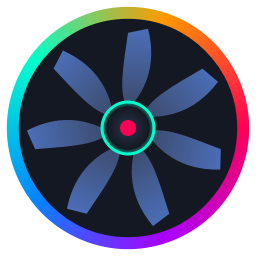
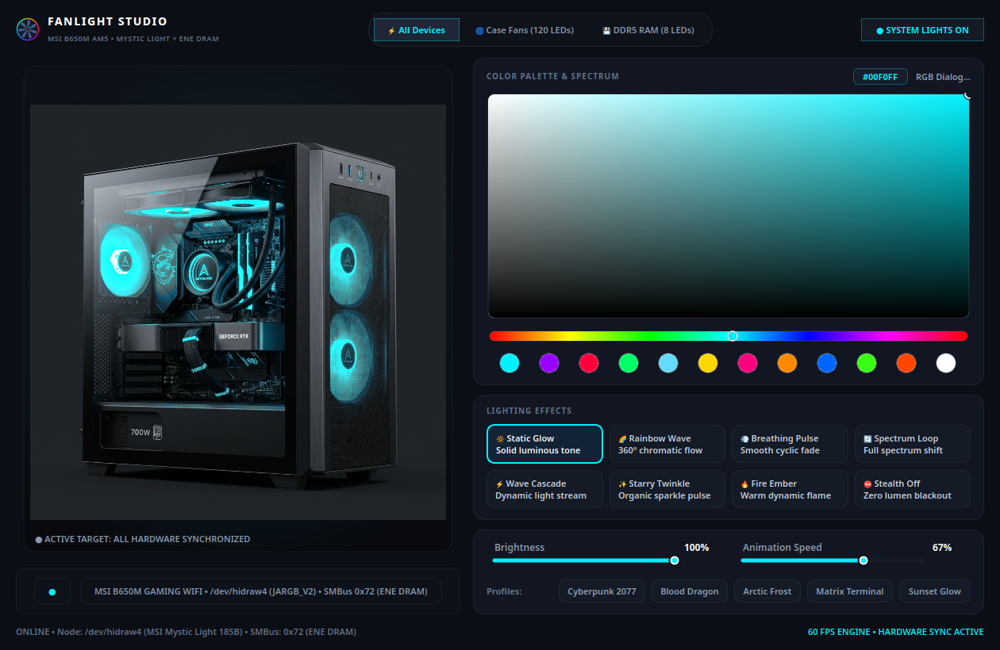
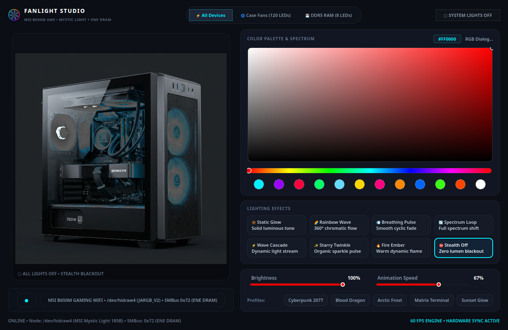
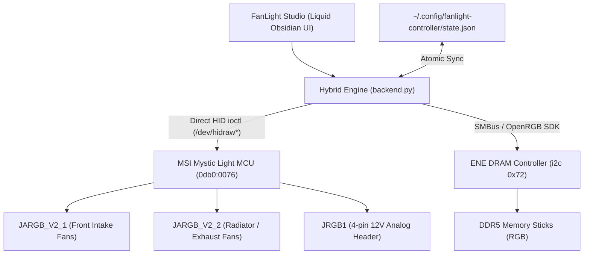

# FanLight Studio

<p align="center">
  
</p>

<p align="center">
  <strong>Next-Generation Linux Desktop Lighting Deck for MSI AM5 Motherboard ARGB Headers & DDR5 RAM RGB</strong>
</p>

<p align="center">
  
  
  
  
  
</p>

---

## 🌟 Visual Showcase

<p align="center">
  
</p>

<p align="center">
  <em>Liquid Obsidian Studio interface featuring real-time photorealistic 3D chassis illumination, Figma-style 2D SV color canvas, and precision glowing sliders.</em>
</p>

<p align="center">
  
</p>

<p align="center">
  <em>Stealth Blackout mode: zero-lumen power gating with real-time hardware status indicators.</em>
</p>

---

## ⚡ The Engineering Problem Solved

On Linux, controlling case fans plugged into MSI AM5 ARGB headers (`JARGB_V2_1`, `JARGB_V2_2`, `JRGB1`) typically fails using standard open-source tools (e.g. OpenRGB). Users experience a frustrating state where **only RAM RGB lights up while all case fans remain completely dark**.

By reverse-engineering the MSI microcontroller protocol and disassembled Linux drivers (`RGBController_MSIMysticLight185.cpp`), we isolated **three hardware-level root causes**:

1. **Zone LED Count Stripped to Zero (`leds_count == 0`)**:
   Standard drivers default the AM5 `JARGB_V2` LED counts to `0`. In driver assembly (`cmp dword ptr [rdx + 0x3c], 0`), the driver takes a branch that **completely skips transmitting LED data packets** to the headers.
   * **FanLight Solution**: Explicitly programs and enforces 120 LEDs on both `JARGB_V2_1` (`buf[41] = 120`) and `JARGB_V2_2` (`buf[52] = 120`).

2. **Bit 7 Power Gating Pulled Low (`and edx, 0x7F`)**:
   On MSI AM5 boards (PID `0x0076`), **Bit 7 (`0x80`) of the speed/brightness byte is the physical hardware power gate**. When standard drivers mask bytes with `0x7F`, Bit 7 is stripped, leaving the physical 5V ARGB data line unpowered.
   * **FanLight Solution**: Direct kernel driver sets:
     $$\text{Flags} = (\text{brightness} \ll 2) \mid \text{speed} \mid 0\text{x}80$$

3. **Microcontroller Two-Step Commit State Machine**:
   The MSI MCU ignores configurations unless committed via a two-step sequence in Feature Report `0x52`:
   - Step 1: Send volatile live update with `buf[184] = 0`.
   - Step 2: Send non-volatile flash commit with `buf[184] = 1`.

4. **Hardware Bus Collisions**:
   OpenRGB background daemons inadvertently probe `/dev/hidraw*` and overwrite registers with 0 LEDs.
   * **FanLight Solution**: Complete decoupling. Case fans are driven directly via Linux kernel HID ioctls (`MSIMysticLightDirect`), while DRAM is driven via SMBus.

---

## 📐 System Architecture



---

## ✨ Features

- **🖥️ Photorealistic 3D Rig Visualizer (`Chassis3DViewer`)**:
  - Real-time compositing using NumPy and QImage with zero CPU overhead.
  - Fans, cooler waterblock, and RAM glow dynamically with chosen colors and effects.
  - Clickable targeting hotspots for **Case Fans (120 LEDs)** and **DDR5 RAM (8 LEDs)**.
- **🎨 Studio-Grade Color Deck**:
  - Precision 2D Saturation-Value canvas (Figma / macOS style).
  - 360° Hue rainbow slider with custom glowing thumb ring.
  - 10 curated quick-select vibrant color bubbles.
- **✨ Balanced 2×4 Lighting Effects Matrix**:
  - 🔆 **Static Glow** — Solid luminous tone
  - 🌈 **Rainbow Wave** — 360° chromatic flow
  - 💨 **Breathing Pulse** — Smooth cyclic fade
  - 🔄 **Spectrum Loop** — Full spectrum shift
  - ⚡ **Wave Cascade** — Dynamic light stream
  - ✨ **Starry Twinkle** — Organic sparkle pulse
  - 🔥 **Fire Ember** — Warm dynamic flame
  - ⛔ **Stealth Off** — Zero lumen blackout
- **🎛️ Glowing Linear Sliders**:
  - Fine-grained controls for **Brightness** (0–100%) and **Animation Speed** (0–100%).
- **🌆 Atmospheric Presets**:
  - Instant one-click profiles: *Cyberpunk 2077*, *Blood Dragon*, *Arctic Frost*, *Matrix Terminal*, and *Sunset Glow*.
- **🔄 Bidirectional Live Hardware & State Sync**:
  - Automatically queries live hardware registers on startup. If lights were powered off prior to closing, the UI restores in stealth blackout mode.
  - Atomic configuration caching in `~/.config/fanlight-controller/state.json`.
- **🚀 Standalone Background Operation**:
  - No external OpenRGB window or manual launch needed. All services run headlessly.
  - Minimize to system tray with quick-toggle context actions.

---

## 🧪 Verified & Tested Hardware

| Component | Hardware Specification | Interface |
| :--- | :--- | :--- |
| **Motherboard** | **MSI B650M GAMING WIFI (MS-7E30)** | AM5 Socket / Micro-Star International |
| **BIOS Version** | **1.F2** (AGESA ComboAM5PI) | UEFI Firmware |
| **Processor** | **AMD Ryzen 5 7600** (6 Cores / 12 Threads) | AM5 Raphael |
| **Fan ARGB Controller** | **MSI Mystic Light MCU (VID `0x0DB0`, PID `0x0076`)** | Direct `/dev/hidraw*` Feature Report `0x52` |
| **Fan Headers** | **`JARGB_V2_1`, `JARGB_V2_2` (3-pin 5V ARGB)** & **`JRGB1`** | Motherboard onboard pins |
| **Memory RGB** | **ENE Technology DRAM RGB Controller** | AMD SMBus I2C address `0x72` (`/dev/i2c-1`) |
| **OS Environment** | **Linux (Kernel 6.x+, Kali Linux, Ubuntu 22.04+, Debian, Arch)** | Linux HIDRAW & I2C Subsystems |

*Compatible with MSI B650, B650M, X670, X670E, A620, and Intel 600/700 series motherboards utilizing the 185-byte Mystic Light protocol.*

---

## 📦 Downloads & Prebuilt Packages

Official lightweight packages (~1.5 MB each) are available on the [GitHub Releases Page (v1.0.0)](https://github.com/MdSagorMunshi/fanlight-controller/releases/tag/v1.0.0):

| Platform / Architecture | Package Format | Download Link | Quick Installation / Execution |
| :--- | :--- | :--- | :--- |
| **Linux (x86_64 / amd64)** | `.deb` Package | [`fanlight-studio_1.0.0_amd64.deb`](https://github.com/MdSagorMunshi/fanlight-controller/releases/download/v1.0.0/fanlight-studio_1.0.0_amd64.deb) | `sudo apt install ./fanlight-studio_1.0.0_amd64.deb` |
| **Linux (x86_64 / amd64)** | Portable Tarball | [`fanlight-studio-v1.0.0-linux-x86_64.tar.gz`](https://github.com/MdSagorMunshi/fanlight-controller/releases/download/v1.0.0/fanlight-studio-v1.0.0-linux-x86_64.tar.gz) | `tar -xzf fanlight-studio-*.tar.gz && ./install.sh` |
| **Linux (arm64 / aarch64)** | `.deb` Package | [`fanlight-studio_1.0.0_arm64.deb`](https://github.com/MdSagorMunshi/fanlight-controller/releases/download/v1.0.0/fanlight-studio_1.0.0_arm64.deb) | `sudo apt install ./fanlight-studio_1.0.0_arm64.deb` |
| **Linux (arm64 / aarch64)** | Portable Tarball | [`fanlight-studio-v1.0.0-linux-arm64.tar.gz`](https://github.com/MdSagorMunshi/fanlight-controller/releases/download/v1.0.0/fanlight-studio-v1.0.0-linux-arm64.tar.gz) | `tar -xzf fanlight-studio-*.tar.gz && ./install.sh` |
| **Windows (x86_64 / amd64)** | Portable ZIP | [`fanlight-studio-v1.0.0-windows-portable-x86_64.zip`](https://github.com/MdSagorMunshi/fanlight-controller/releases/download/v1.0.0/fanlight-studio-v1.0.0-windows-portable-x86_64.zip) | Extract and double-click `run_fanlight.bat` |
| **Windows (arm64 / WoA)** | Portable ZIP | [`fanlight-studio-v1.0.0-windows-arm64.zip`](https://github.com/MdSagorMunshi/fanlight-controller/releases/download/v1.0.0/fanlight-studio-v1.0.0-windows-arm64.zip) | Extract and double-click `run_fanlight.bat` |

---

## 🚀 Quick Start & Installation

### Option 1: Automated Installer (Recommended)

Clone the repository and run the automated installer:

```bash
git clone https://github.com/MdSagorMunshi/fanlight-controller.git
cd fanlight-controller
chmod +x install.sh
./install.sh
```

The installer will:
1. Install Python dependencies (`PyQt6`, `pillow`, `numpy`, `openrgb-python`).
2. Configure non-root hardware `udev` rules for MSI Mystic Light and SMBus.
3. Install the `fanlight-studio` CLI command in `~/.local/bin/`.
4. Create the Desktop application shortcut in your applications launcher and desktop.

### Option 2: Manual Setup

1. **Install Python Dependencies**:
   ```bash
   pip3 install -r requirements.txt
   ```

2. **Configure udev Permissions** (allows running without `sudo`):
   Create `/etc/udev/rules.d/60-msi-mysticlight.rules`:
   ```udev
   # MSI Mystic Light USB HID Controller
   SUBSYSTEM=="hidraw", ATTRS{idVendor}=="0db0", ATTRS{idProduct}=="0076", MODE="0666", TAG+="uaccess"
   SUBSYSTEM=="hidraw", ATTRS{idVendor}=="0db0", ATTRS{idProduct}=="0080", MODE="0666", TAG+="uaccess"
   SUBSYSTEM=="hidraw", ATTRS{idVendor}=="0db0", ATTRS{idProduct}=="0083", MODE="0666", TAG+="uaccess"
   SUBSYSTEM=="hidraw", ATTRS{idVendor}=="0db0", ATTRS{idProduct}=="0087", MODE="0666", TAG+="uaccess"

   # SMBus I2C access for DDR5/DDR4 RGB RAM
   KERNEL=="i2c-[0-9]*", GROUP="i2c", MODE="0666"
   ```
   Reload udev rules:
   ```bash
   sudo udevadm control --reload-rules && sudo udevadm trigger
   ```

3. **Launch the Application**:
   ```bash
   python3 main.py
   ```

---

## 🔬 Protocol Specification (Report `0x52`)

Direct USB communication with the MSI microcontroller is performed via Linux HID feature report ioctls:
- `HIDIOCGFEATURE(185) = 0xC0004807 | (185 << 16)`
- `HIDIOCSFEATURE(185) = 0xC0004806 | (185 << 16)`

```text
Byte Offset   Target Zone / Function           Length (bytes)
--------------------------------------------------------------
0x00 (0)      Report ID (0x52)                 1 byte
0x01 (1)      JRGB1 (4-pin 12V RGB)            10 bytes
0x1F (31)     JRAINBOW1 / JARGB_V2_1 Fans      11 bytes (ends with leds_count at 41)
0x2A (42)     JRAINBOW2 / JARGB_V2_2 Fans      11 bytes (ends with leds_count at 52)
0x35 (53)     JRAINBOW3                        11 bytes
0x4A (74)     ONBOARD Motherboard Lighting     10 bytes
0xB8 (184)    Save Flag (0 = Live, 1 = Flash)  1 byte
```

Each 11-byte ARGB zone payload:
```text
[EffectID, Red, Green, Blue, SpeedBrightnessFlags, Red2, Green2, Blue2, ColorFlags, Padding, LEDCount]
```

---

## 🛠️ Troubleshooting

### 1. Permission Denied on `/dev/hidraw*`
Run `./install.sh` or check your user permissions:
```bash
ls -l /dev/hidraw*
# Ensure your user has read/write permissions (crw-rw-rw-)
```

### 2. Device Node Re-enumeration
On USB reset or boot, the Linux kernel may move the controller between `/dev/hidraw4` and `/dev/hidraw6`. FanLight Studio includes a dynamic node scanner that automatically parses `/sys/class/hidraw/*/device/uevent` for `00000DB0:00000076` so no manual reconfiguration is ever needed.

### 3. RAM RGB Not Detected
Ensure the Linux kernel `i2c-dev` module is loaded:
```bash
sudo modprobe i2c-dev
```
To load it automatically on every boot:
```bash
echo "i2c-dev" | sudo tee /etc/modules-load.d/i2c-dev.conf
```

---

## 🤝 Contributing

We welcome contributions from the hardware and open-source community! Whether you are adding support for another MSI motherboard model, fixing a driver quirk, creating new lighting animations, or improving documentation:

- 📖 **Contribution Guidelines**: Please read our [CONTRIBUTING.md](CONTRIBUTING.md) guide for local environment setup, architecture notes, and code style.
- 🐛 **Report a Bug**: Use our [Bug Report Form](https://github.com/MdSagorMunshi/fanlight-controller/issues/new?template=bug_report.yml) to submit detailed hardware logs.
- 💡 **Request a Feature**: Propose new lighting modes or integrations via our [Feature Request Form](https://github.com/MdSagorMunshi/fanlight-controller/issues/new?template=feature_request.yml).
- 🎮 **Submit Tested Hardware**: Tested FanLight Studio on your motherboard? Report it using the [Hardware Compatibility Form](https://github.com/MdSagorMunshi/fanlight-controller/issues/new?template=hardware_compatibility.yml) to expand our verified matrix.
- 🔀 **Submit a Pull Request**: Check out our [PR Template](.github/pull_request_template.md) to ensure your changes are ready for review.

---

## 📄 License

Distributed under the **MIT License**. See [LICENSE](LICENSE) for details.

---

<p align="center">
  Crafted with care for the Linux gaming & hardware enthusiast community.
</p>
